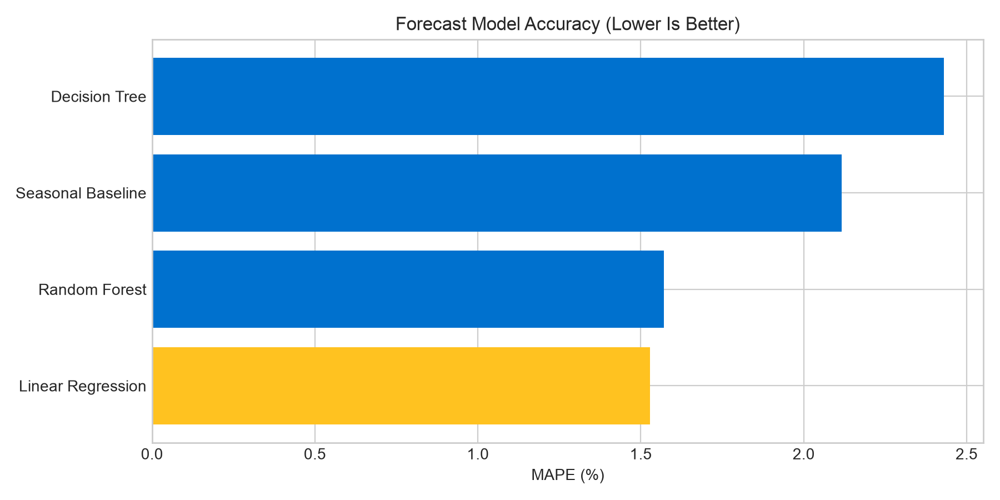

# Walmart Retail Sales Analytics & Forecasting

An end-to-end retail analytics portfolio project combining Python analysis, machine-learning forecasting, and an interactive Power BI dashboard. The project analyses 421,570 store-department-week records to identify sales patterns, investigate negative sales, and forecast the next 12 weeks.


## Explore the project

| Deliverable | Link |
|---|---|
| Interactive dashboard source | [Download the editable Power BI report (.pbix)](powerbi/Walmart_Retail_Analytics.pbix) |
| Complete analysis | [Open the beginner-friendly executed notebook](notebooks/walmart_retail_analytics.ipynb) |
| Browser-friendly analysis | [View the standalone HTML report](reports/walmart_retail_analytics.html) |
| Dashboard dataset | [Download the prepared Excel workbook](outputs/walmart_powerbi_dashboard.xlsx) |

> GitHub displays the dashboard preview above. To explore filters and visuals interactively, download the `.pbix` file and open it in Power BI Desktop.

## Project at a glance

- **Goal:** Turn historical Walmart sales data into actionable operational insights and a 12-week sales forecast.
- **Data:** 421,570 weekly sales records across stores and departments.
- **Analysis:** Seasonality, holiday behaviour, negative sales, store anomalies, and department trends.
- **Models compared:** Linear Regression, Random Forest, Decision Tree, and a seasonal baseline.
- **Best model:** Linear Regression with a test MAPE of **1.53%**.
- **Output:** A branded Power BI dashboard supported by reproducible Python analysis.

## Key business insights

- Weekly sales generally remain between **40M and 50M**, with pronounced Thanksgiving and Christmas peaks.
- Department 47 shows a company-wide negative-sales pattern rather than an isolated store problem.
- Store 35 is a major anomaly for two departments:
  - Department 49: **35.09%** negative-sales rate versus **1.06%** at other stores.
  - Department 80: **18.66%** versus **0.75%** at other stores.
- Department 47's negative-sales rate increased from roughly **33% in 2010** to **46% in 2012**.
- Holiday status does not appear to be the primary cause of Department 47's negative sales.

## Forecasting results

| Model | MAE | RMSE | MAPE |
|---|---:|---:|---:|
| **Linear Regression** | **702,395** | **890,071** | **1.53%** |
| Random Forest | 718,645 | 1,116,384 | 1.57% |
| Seasonal Baseline | 974,642 | 1,160,987 | 2.12% |
| Decision Tree | 1,103,849 | 1,360,534 | 2.43% |

Linear Regression was selected because it produced the lowest test error and remained easy to explain. The 12-week forecast captures expected seasonal peaks, including approximately **64.1M for Thanksgiving week** and **72.8M before Christmas**.



## Recommendations

1. Audit Store 35's returns, refunds, inventory adjustments, and data-entry processes for Departments 49 and 80.
2. Investigate Department 47 at the company level rather than treating it as a single-store issue.
3. Increase inventory and staffing capacity around recurring Thanksgiving and Christmas peaks.
4. Refresh the forecasting pipeline as new weekly sales data becomes available.

## Tools and skills demonstrated

- **Python:** pandas, NumPy, Matplotlib
- **Machine learning:** scikit-learn, time-based validation, regression metrics
- **Business intelligence:** Power BI, dashboard design, data storytelling
- **Data preparation:** CSV and Excel exports, validation, aggregation
- **Analysis:** exploratory analysis, anomaly investigation, forecasting

## Repository structure

```text
├── assets/       # Dashboard preview
├── notebooks/    # Clean, executed analysis notebook
├── outputs/      # Forecasts, charts, summary tables, and dashboard workbook
├── powerbi/      # Editable Power BI report (.pbix)
├── reports/      # Browser-friendly HTML analysis
├── README.md
└── requirements.txt
```

## Reproduce the analysis

```bash
python -m venv .venv
source .venv/bin/activate
pip install -r requirements.txt
jupyter notebook notebooks/walmart_retail_analytics.ipynb
```

Run the notebook from top to bottom to regenerate the charts, summary tables, forecast, and Power BI workbook in `outputs/`.

## Limitations

- Negative sales may represent legitimate returns or accounting corrections; transaction-level reasons are unavailable.
- Model evaluation uses one 12-week holdout period. Rolling time-series validation would provide stronger confirmation.
- The current forecast targets company-wide weekly sales. A future version could forecast store-department combinations and include temperature, CPI, fuel prices, and unemployment.

## Data source

Walmart Recruiting — Store Sales Forecasting dataset, originally published on Kaggle. Raw data is excluded from this repository and must be downloaded separately.
