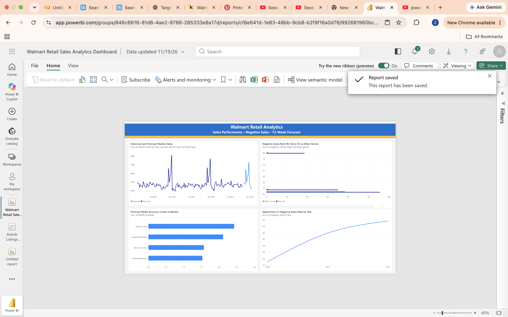

# Walmart Retail Sales Analytics and Forecasting

An end-to-end retail analytics project using Walmart's historical store-sales data. The project combines exploratory analysis, a focused negative-sales investigation, machine-learning forecasting, and a Power BI dashboard.



## Business questions

- What patterns and seasonality appear in Walmart's weekly sales?
- Are negative sales isolated or systematic?
- Why does Store 35 stand out in the negative-sales analysis?
- Which beginner-friendly forecasting model performs best on unseen weeks?
- What sales should the business expect over the next 12 weeks?

## Project workflow

1. Validated 421,570 store-department-week records.
2. Analysed weekly sales, holiday behaviour, stores, and departments.
3. Investigated negative sales by department, store, holiday status, and year.
4. Created a chronological 131-week training and 12-week test split.
5. Compared a seasonal baseline, Linear Regression, Decision Tree, and Random Forest.
6. Retrained the winning model and produced a 12-week forecast.
7. Exported dashboard-ready tables to Excel and built a branded Power BI report.

## View the analysis

- [Download the editable Power BI report (.pbix)](powerbi/Walmart_Retail_Analytics.pbix)
- [Clean executed notebook](notebooks/walmart_retail_analytics.ipynb)
- [Standalone HTML report](reports/walmart_retail_analytics.html)
- [Interview preparation guide](reports/interview_guide.md)
- [Résumé bullets](reports/resume_bullets.md)

### Open the Power BI dashboard

Download `powerbi/Walmart_Retail_Analytics.pbix` and open it with Power BI Desktop. The repository also includes a dashboard screenshot for quick browser viewing and the dashboard-ready Excel workbook in `outputs/`.

## Key findings

- Weekly sales normally sit around 40–50 million, with major Thanksgiving and Christmas peaks.
- Department 47 has a widespread negative-sales pattern across stores.
- Store 35 is a clear anomaly for Departments 49 and 80:
  - Department 49: 35.09% negative rate in Store 35 versus 1.06% elsewhere.
  - Department 80: 18.66% versus 0.75% elsewhere.
- Holiday and non-holiday negative rates for Department 47 are very similar, so holidays do not appear to be the main cause.
- Department 47's negative-sales rate increased from about 33% in 2010 to about 46% in 2012, although later negative transactions were generally less severe.

## Forecasting results

| Model | MAE | RMSE | MAPE |
|---|---:|---:|---:|
| Linear Regression | 702,395 | 890,071 | **1.53%** |
| Random Forest | 718,645 | 1,116,384 | 1.57% |
| Seasonal Baseline | 974,642 | 1,160,987 | 2.12% |
| Decision Tree | 1,103,849 | 1,360,534 | 2.43% |

Linear Regression was selected because it delivered the lowest test error while remaining easy to explain. The final forecast captures the expected holiday peaks, including approximately 64.1 million for Thanksgiving week and 72.8 million before Christmas.

## Business recommendations

- Review Store 35's returns, refund, inventory-adjustment, and data-entry processes for Departments 49 and 80.
- Investigate Department 47 at the company level rather than treating it as a single-store issue.
- Plan inventory and staffing for recurring Thanksgiving and Christmas sales peaks.
- Use the forecast as a planning baseline and refresh it as new weekly sales arrive.

## Tools

- Python: pandas, NumPy, Matplotlib
- Machine learning: scikit-learn
- Notebook: Jupyter
- Dashboard: Power BI Service
- Data exchange: CSV and Excel

## Repository structure

```text
Retail-Analytics-Project/
├── assets/
│   └── powerbi-dashboard.png
├── archive/
│   └── python_original.ipynb
├── data/
│   └── walmart-recruiting-store-sales-forecasting/
├── notebooks/
│   └── walmart_retail_analytics.ipynb
├── outputs/
│   ├── charts and summary CSVs
│   └── walmart_powerbi_dashboard.xlsx
├── powerbi/
│   └── Walmart_Retail_Analytics.pbix
├── reports/
│   ├── interview_guide.md
│   └── resume_bullets.md
├── scripts/
│   └── build_clean_notebook.py
├── README.md
└── requirements.txt
```

## Run the project

```bash
python -m venv .venv
source .venv/bin/activate
pip install -r requirements.txt
jupyter notebook notebooks/walmart_retail_analytics.ipynb
```

Run the notebook from top to bottom. It regenerates the charts, summary tables, 12-week forecast, and Power BI workbook inside `outputs/`.

## Limitations and next steps

- Negative sales may be legitimate returns or accounting corrections; the dataset does not provide transaction reasons.
- Evaluation uses one 12-week holdout. Rolling time-series validation would strengthen the comparison.
- The current target is company-wide weekly sales. A future version could forecast each store-department combination and incorporate external features such as temperature, CPI, fuel prices, and unemployment.

## Data source

Walmart Recruiting — Store Sales Forecasting dataset, originally published on Kaggle. Raw datasets are excluded from version control; download them separately and place them in `data/walmart-recruiting-store-sales-forecasting/`.
